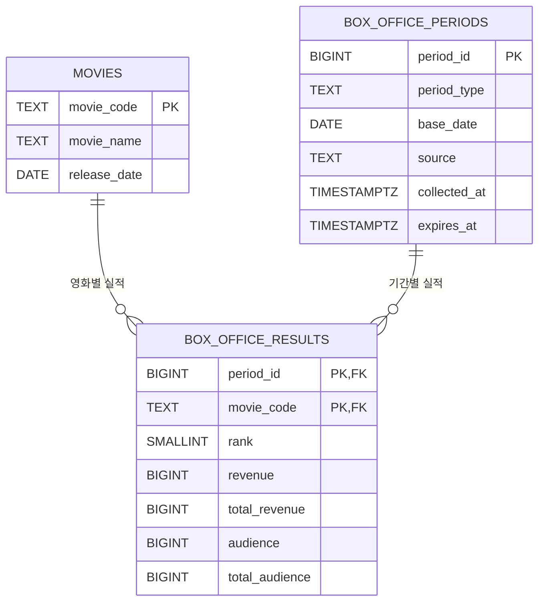

# 박스오피스 데이터 ERD

## 목적과 저장 단위

박스오피스 데이터는 영화의 변하지 않는 식별 정보, 조회한 기간, 해당 기간에 관측된 실적으로 나눈다. 한 `box_office_periods` 행은 기간 유형과 기준일의 한 번의 조회 스냅샷을 나타낸다. 조회는 성공했지만 결과가 없는 날짜도 기간 행으로 저장하고, 자식 실적 행은 0개로 둔다. 이를 통해 정상 빈 결과와 조회 실패를 구분할 수 있다.

금액·관객·순위 수치는 KOBIS 원문에서 문자열일 수 있으므로 서버에서 검증 후 정수로 정규화해 저장한다. API 원문 전체와 비밀 키는 저장하지 않는다.

## 저장해야 할 데이터

- **영화 정보:** 영화 코드, 영화명, 개봉일
- **조회 기간:** 기간 유형(일간·주간·주말), 기준일. 조회 출처와 수집 시각은 운영·캐시 검증을 위해 함께 저장한다.
- **기간별 영화 실적:** 영화, 조회 기간, 순위, 매출액(원), 관객수(명), 누적 관객수(명)

## 단일 테이블로 저장할 때의 이상

영화 정보와 날짜별 실적을 한 표에 반복 저장하면 아래 문제가 생긴다.

| 이상 | 예시 | 결과 |
|---|---|---|
| 삽입 이상 | 아직 조회 실적이 없는 영화의 코드·이름·개봉일만 등록하려면 기간/순위/매출 같은 실적 값을 함께 채워야 함 | 실적이 없다는 이유로 영화 정보를 독립적으로 저장할 수 없거나 가짜 값을 넣게 됨 |
| 수정 이상 | 영화명이 변경되면 영화가 등장한 모든 기간 행의 이름을 갱신해야 함 | 일부 행만 수정하면 같은 코드에 이름이 여러 개가 되는 불일치 발생 |
| 삭제 이상 | 특정 기간의 마지막 실적 행을 삭제함 | 그 행에 중복 저장된 영화 정보나 해당 조회 기간 정보까지 잃을 수 있음 |

## 테이블 설계

### `movies` — 영화

| 컬럼 | 형식 | 제약 | 설명 |
|---|---|---|---|
| `movie_code` | `TEXT` | PK, NOT NULL | KOBIS 영화 식별 코드 |
| `movie_name` | `TEXT` | NOT NULL | 영화명 |
| `release_date` | `DATE` | NULL 허용 | 개봉일. 미제공/미확정이면 NULL |

### `box_office_periods` — 조회 기간 스냅샷

| 컬럼 | 형식 | 제약 | 설명 |
|---|---|---|---|
| `period_id` | `BIGINT` identity | PK | 한 번의 기간 조회 스냅샷 ID |
| `period_type` | `TEXT` | NOT NULL, CHECK (`daily`, `weekly`, `weekend`) | 기간 유형 |
| `base_date` | `DATE` | NOT NULL | KOBIS 조회 기준일 |
| `source` | `TEXT` | NOT NULL | 예: `KOBIS` 또는 `KOBIS_DEMO` |
| `collected_at` | `TIMESTAMPTZ` | NOT NULL | 조회 성공 응답을 받은 시각 |
| `expires_at` | `TIMESTAMPTZ` | NULL 허용 | 캐시 만료 시각. 캐시 정책 적용 시 기록 |
| `(period_type, base_date)` | — | UNIQUE | 같은 유형·기준일의 중복 스냅샷 방지. 재수집은 upsert |

### `box_office_results` — 기간별 영화 실적

| 컬럼 | 형식 | 제약 | 설명 |
|---|---|---|---|
| `period_id` | `BIGINT` | PK 일부, FK → `box_office_periods.period_id`, NOT NULL | 조회 기간 스냅샷 |
| `movie_code` | `TEXT` | PK 일부, FK → `movies.movie_code`, NOT NULL | 영화 |
| `rank` | `SMALLINT` | NOT NULL, CHECK (`rank > 0`) | 해당 조회의 순위 |
| `revenue` | `BIGINT` | NOT NULL, CHECK (`revenue >= 0`) | 기간 매출액(원) |
| `total_revenue` | `BIGINT` | NOT NULL, CHECK (`total_revenue >= 0`) | 누적 매출액(원) |
| `audience` | `BIGINT` | NOT NULL, CHECK (`audience >= 0`) | 기간 관객수(명) |
| `total_audience` | `BIGINT` | NOT NULL, CHECK (`total_audience >= 0`) | 누적 관객수(명) |
| `(period_id, movie_code)` | — | PK | 한 조회 스냅샷에서 같은 영화를 한 번만 저장 |
| `(period_id, rank)` | — | UNIQUE | 한 조회에서 순위 중복 방지 |

실적 테이블의 복합 기본키는 한 영화가 여러 날짜·기간에 등장하는 것을 허용하면서 동일 기간의 중복 실적을 막는다. 외래키의 기본 동작은 삭제 제한으로 두어 참조 중인 영화나 기간을 실수로 지우지 않게 한다. 기간을 재수집할 때는 한 트랜잭션에서 실적을 교체하고 기간 메타데이터를 갱신한다.

## 관계도



기간 테이블의 `period_type`과 `base_date`는 함께 UNIQUE이며, 결과 테이블의 `period_id`와 `movie_code`는 함께 PK다. Mermaid의 `UK` 표기는 복합 UNIQUE 제약의 구성 컬럼을 뜻한다.

## 예시 데이터: 영화 2개, 날짜 3일

예시는 모두 가상 값이다. 기간 행은 9월 4일·5일·6일에 만들고, 9월 6일에는 성공한 조회 결과가 0건이라 실적 행을 넣지 않는다.

### `movies`

| movie_code | movie_name | release_date |
|---|---|---|
| `M001` | 달빛 항해 | 2026-08-20 |
| `M002` | 바다의 노래 | 2026-08-28 |

### `box_office_periods`

| period_id | period_type | base_date | source | collected_at |
|---:|---|---|---|---|
| 101 | daily | 2026-09-04 | KOBIS_DEMO | 2026-09-05 01:10+09 |
| 102 | daily | 2026-09-05 | KOBIS_DEMO | 2026-09-06 01:10+09 |
| 103 | daily | 2026-09-06 | KOBIS_DEMO | 2026-09-07 01:10+09 |

### `box_office_results`

| period_id | movie_code | rank | revenue | total_revenue | audience | total_audience |
|---:|---|---:|---:|---:|---:|---:|
| 101 | M001 | 1 | 100000000 | 800000000 | 10000 | 500000 |
| 101 | M002 | 2 | 70000000 | 400000000 | 7000 | 300000 |
| 102 | M002 | 1 | 120000000 | 520000000 | 12000 | 312000 |
| 102 | M001 | 2 | 90000000 | 890000000 | 9000 | 509000 |

`period_id=103`은 존재하지만 이를 참조하는 실적 행은 없다. 이 조합은 “9월 6일 조회 성공, 결과 없음”을 표현하며 API 장애나 수집 실패와 구분된다.

## 조회 예시: 날짜별 목록과 정상 빈 날짜

```sql
SELECT
    p.base_date,
    p.period_type,
    r.rank,
    m.movie_code,
    m.movie_name,
    m.release_date,
    r.revenue,
    r.total_revenue,
    r.audience,
    r.total_audience,
    p.source,
    p.collected_at
FROM box_office_periods AS p
LEFT JOIN box_office_results AS r
    ON r.period_id = p.period_id
LEFT JOIN movies AS m
    ON m.movie_code = r.movie_code
WHERE p.period_type = 'daily'
  AND p.base_date BETWEEN DATE '2026-09-04' AND DATE '2026-09-06'
ORDER BY p.base_date, r.rank;
```

기간 테이블에서 결과 테이블로 `LEFT JOIN`하기 때문에 실적이 0건인 9월 6일도 날짜 행으로 반환되며, 그 날짜의 영화·순위·수치는 NULL이다. 특정 날짜의 실제 영화 목록만 필요하면 기준일을 하나로 좁히고 `r.movie_code IS NOT NULL`을 추가하거나 `INNER JOIN`을 사용한다.

## 저장 규칙

- 먼저 영화 코드를 기준으로 `movies`를 upsert하고, `(period_type, base_date)`로 기간 스냅샷을 upsert한다.
- 같은 트랜잭션에서 해당 `period_id`의 이전 실적을 교체하고 새 `box_office_results`를 저장한다. 빈 결과여도 기간 행은 남기고 실적 행은 0개로 둔다.
- KOBIS 호출 실패나 응답 검증 실패는 정상 빈 조회로 저장하지 않는다.
- API 키는 어느 테이블에도 저장하지 않는다. `source`와 `collected_at`은 샘플/실제 출처와 최신성 표시를 위한 메타데이터다.
